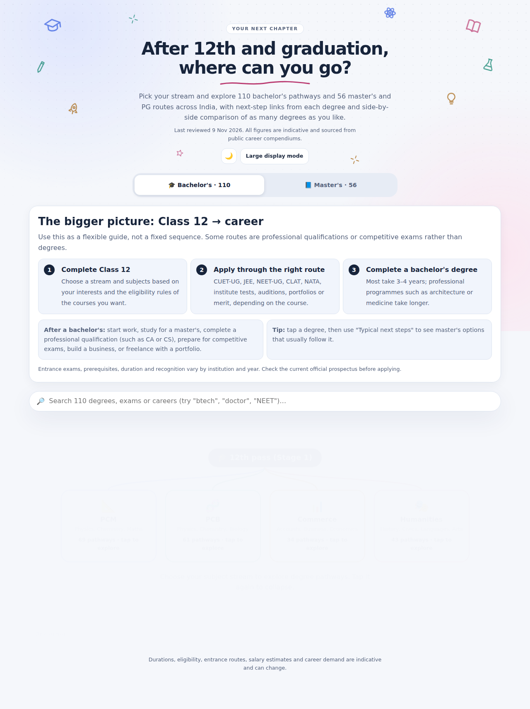

# After 12th Roadmap

An interactive web application helping students explore bachelor's and master's degree pathways across India after 12th grade and graduation. It provides a flexible guide and maps out typical next steps, expected salary ranges, career demand, and eligibility criteria for various streams including PCM, PCB, Commerce, and Humanities.

## Features

- **Degree Map by Stream**: Interactive visualization of pathways categorized by subject streams (PCM, PCB, Commerce, Humanities).
- **Master's and PG Routes**: Detailed information on what comes after a bachelor's degree, including R&D, PhD, specialisations, and certifications.
- **Search Capabilities**: Fuzzy search functionality for finding specific degrees, exams, or careers.
- **Side-by-Side Comparison**: Compare multiple degrees at once, analyzing duration, entrance requirements, expected salaries, and more.
- **Responsive & Accessible Design**: Supports both dark and light modes, works seamlessly across devices (including large display mode), and respects system accessibility settings.

## Preview



## Data

The roadmap data is stored in `data.json`, making it easy to update or connect to a dynamic API backend in the future.

## Local Development

The app works best when served via a local web server (instead of opening the `index.html` file directly) to properly fetch the `data.json` file.

You can use any simple HTTP server, for example:

```bash
# Using Python
python3 -m http.server 8080

# Using Node.js
npx http-server -p 8080
```

Then visit `http://localhost:8080` in your browser.